<p align="center">
  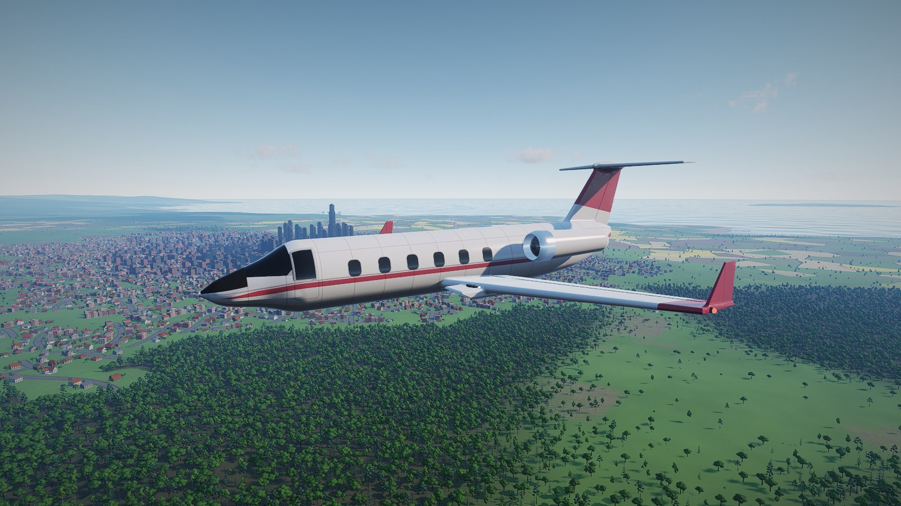
</p>

<h1 align="center">Somnium Volandi</h1>

<p align="center">
  <b>A pilot-career flight game for Windows.</b><br>
  Start with a student permit in a two-seat trainer and work up to an airline transport licence, a fleet of your own
  and an airline, over a hand-built archipelago and thousands of generated island regions on a full-size Earth,
  from runways and, in an amphibian, from the water.
</p>

<p align="center">
  <a href="../../releases/latest"><b>Download</b></a> ·
  <a href="RELEASE_NOTES.md">What's new</a> ·
  <a href="#controls">Controls</a> ·
  <a href="#building-from-source">Build from source</a> ·
  <a href="#documentation">Docs</a>
</p>

<p align="center">
  <a href="../../actions/workflows/build.yml"></a>
</p>

---

## The game

You learn to fly at Meadowbrook's flight school, then work. You rent small planes to haul cargo and bigger ones to fly
passengers, earn your Private, Commercial and Airline Transport licences, and buy aircraft of your own for longer,
harder contracts: mountain strips, glacier runways, volcano fields, medevacs against the clock and night freight in
the rain. In the end you run your own airline while you fly your own work.

Everything is simulated rather than scripted. The aerodynamics come from each airframe's shape, the weather is a wind
field you fly through, the tower talks to you from what is actually happening, and the autopilot learns each type by
flying it. The islands are a lived-in place, with towns and traffic. Past their horizon the ocean goes on to 6,143
generated regions, each with its own airports, towns and sights, and the career can follow you there.

<table>
  <tr>
    <td width="50%">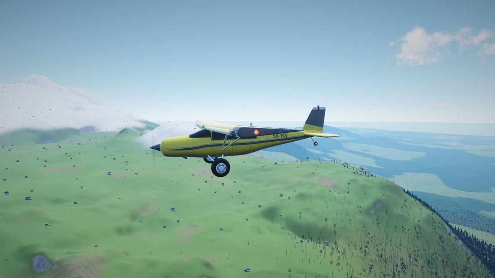</td>
    <td width="50%">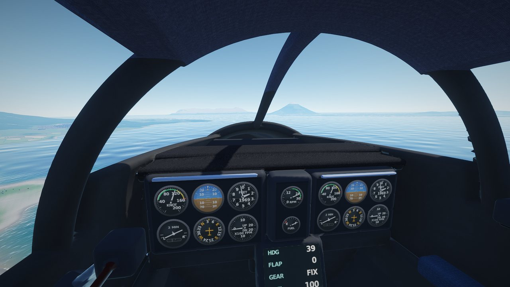</td>
  </tr>
  <tr>
    <td>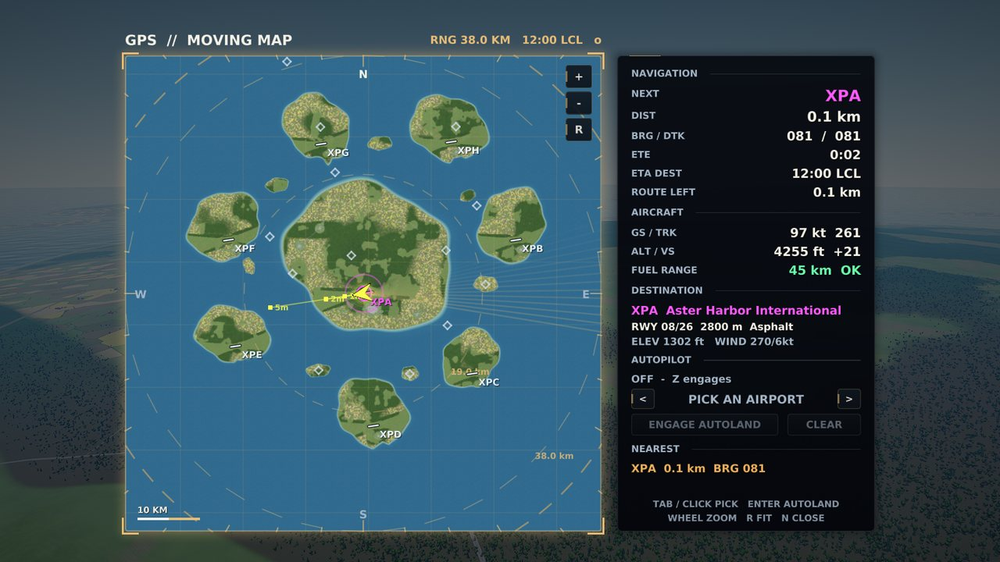</td>
    <td>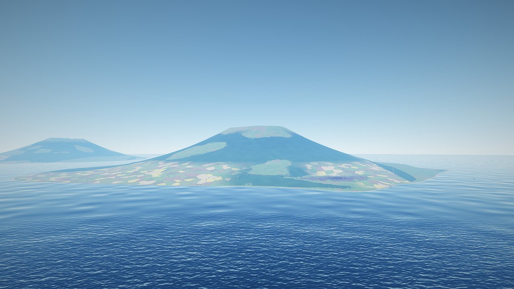</td>
  </tr>
  <tr>
    <td>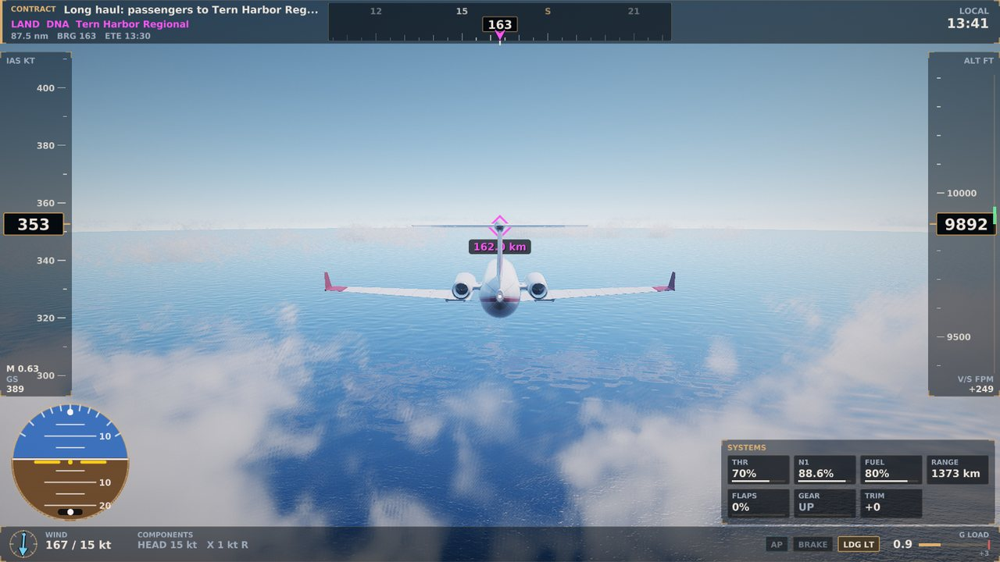</td>
    <td>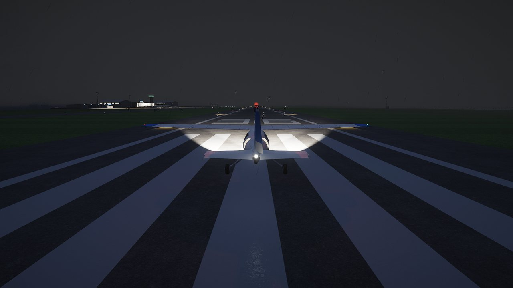</td>
  </tr>
  <tr>
    <td>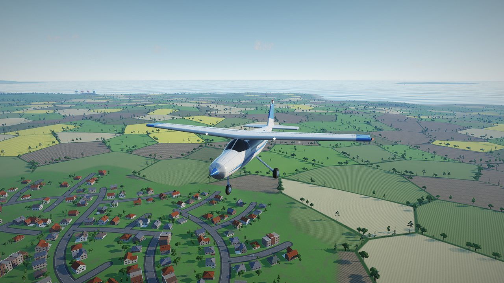</td>
    <td>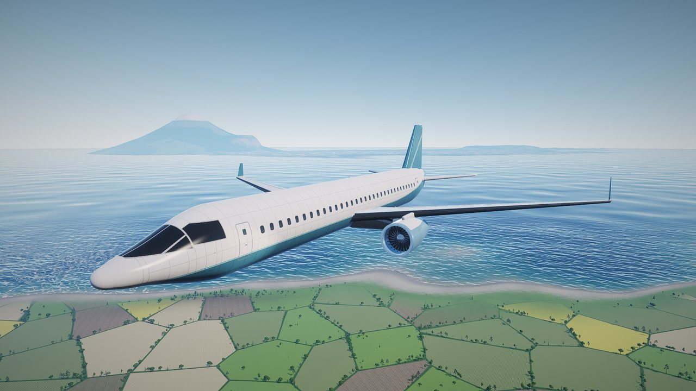</td>
  </tr>
  <tr>
    <td>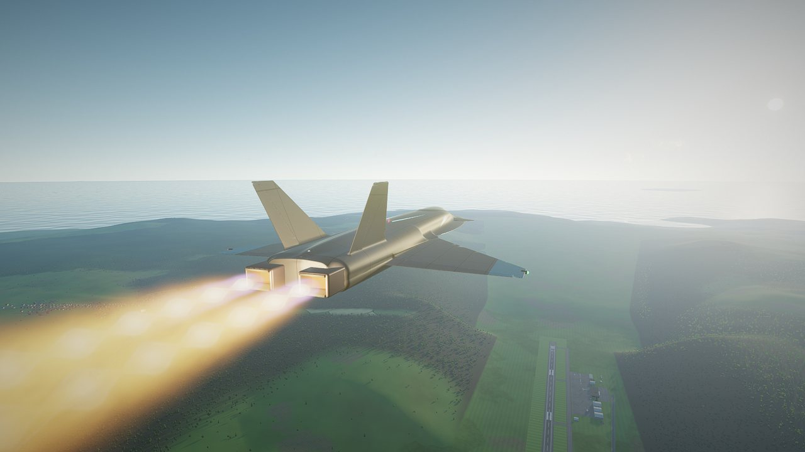</td>
    <td>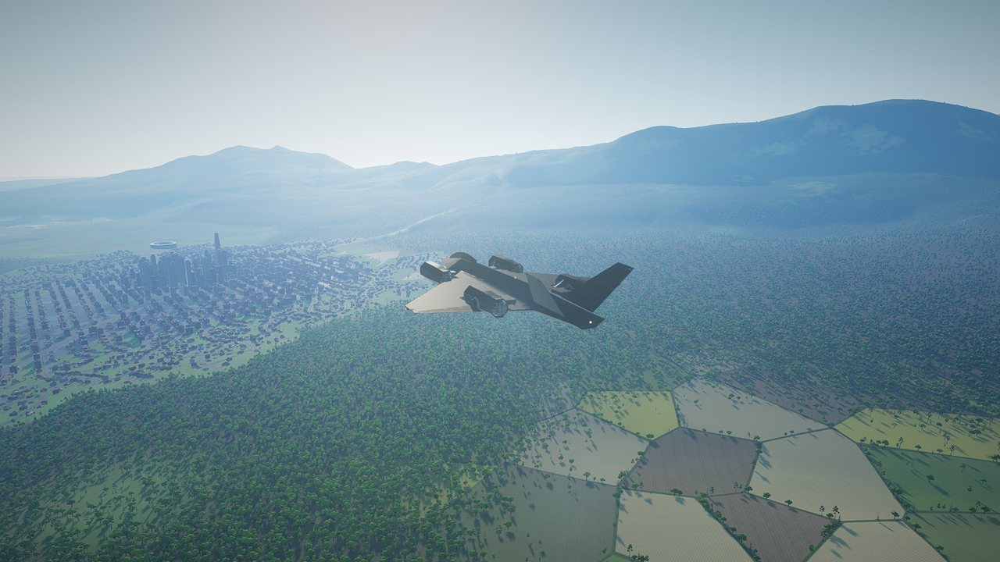</td>
  </tr>
</table>

## Features

### A career from student to airline owner

- **Licences and a story.** 4 lessons and 30 story contracts in 5 chapters (Student, Private, Commercial,
  owner-operator, Airline Transport), plus an endless freelance board.
- **Real work.** Cargo, passengers, fragile loads, medevacs with a deadline and a patient to keep comfortable, VIP
  charters with a live comfort meter, night freight, low-visibility runs flown to minimums, altitude surveys, scenic
  tours and photo flights over landmarks.
- **Every flight scored.** You're graded on the touchdown, the zone, the centreline and the approach, on passenger
  comfort and deadlines, and on airmanship from what the flight recorder saw, including whether you followed the
  tower's instructions.
- **An economy that holds together.** Rent at any airport, or buy and sell aircraft (new, used or financed), pay for
  ferry flights and positioning tickets, and buy fuel at the departure. The job board quotes each job for the
  aircraft you pick: it flies the job on the autopilot in the background, then shows the time, the fuel, the costs
  and your net. Owned aircraft wear, need servicing and can fail in flight; the hangar sells insurance.
- **A hangar at the airport.** The aircraft you're looking at stands on the apron in front of one of the field's own
  hangars, rendered live, so its size reads against the buildings around it.
- **A mechanic in the hangar.** Six kits for an aircraft you own: an engine overhaul, a composite propeller, a speed
  kit, a lightweight interior, long-range tanks and a STOL kit. Each changes how it flies in the flight model, and
  they stack.
- **Jobs survive a diversion.** Land short and the leg closes; the job waits where the load is until you fly it on.
- **Your airline.** Hired pilots fly your aircraft on routes and pay into your account, and their flights pass you
  as traffic in your livery.
- **After the campaign:** legendary contracts, trials (spot landings, a STOL contest, gate runs with medals and a
  ghost of your best run), the Defense Command board with its XR sorties, and Project NIGHTGLASS, the research
  terminal.
- **No softlocks.** Every contract can be flown with an aircraft you can rent or afford, and that is checked
  automatically (`tests/progression_test.cpp`).

<table>
  <tr>
    <td width="50%">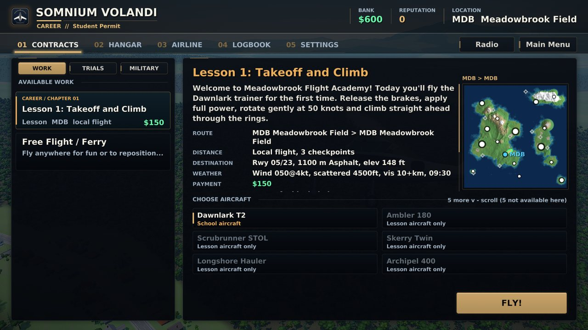</td>
    <td width="50%">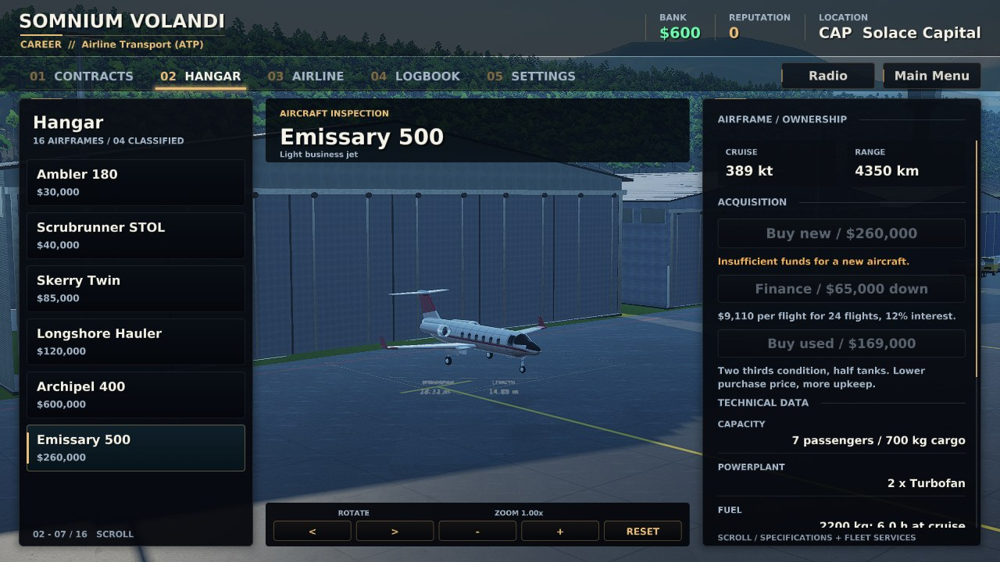</td>
  </tr>
</table>

### The Solace Islands, and the world beyond

- **A hand-built archipelago.** 16 airports and 7 seaplane bases on 5 islands: a flight-school field, grass farm strips, a rock in the
  sea, international hubs at Port Verde and Solace Capital, a gravel strip high on a mountain pass, a volcano research strip, a glacier snow
  runway, a fjord town and a resort isle. There are 26 settlements, from three cities to small villages, joined by a
  graded road network with bridges, traffic and ferries. Add farms, a container port, a stadium, a racetrack, a dam,
  a wind farm, a cable-stayed bridge and a lighthouse that turns.
- **6,143 generated regions.** Around the islands, regions at stable addresses on the globe, each worked out from
  its address: archipelagos, volcanic chains, fjords, atolls and continental fragments. They come in three sizes.
  A small one has a few islands and two or three fields. A large one is on Solace's own scale, with a city round an
  international airport and up to ten fields. They rise over the horizon as you fly toward them and are solid
  ground when you arrive.
- **Worth exploring.** Each region has its own sights (craters, summits, capes, islets, sounds, lagoons, fjord
  heads, straits), named for that region and marked on the maps. Your passport keeps a page for every region:
  the airports you've landed at and the sights you've found.
- **The career goes too.** Fly to another region by airline ticket and work its own job board. Your aircraft stay
  where you park them. With an aircraft that has the range, take a **long haul** and fly a load there yourself,
  across the open ocean. On the real Earth the board lists intercontinental hubs 3,000 to 9,000 km away.

<table>
  <tr>
    <td width="50%">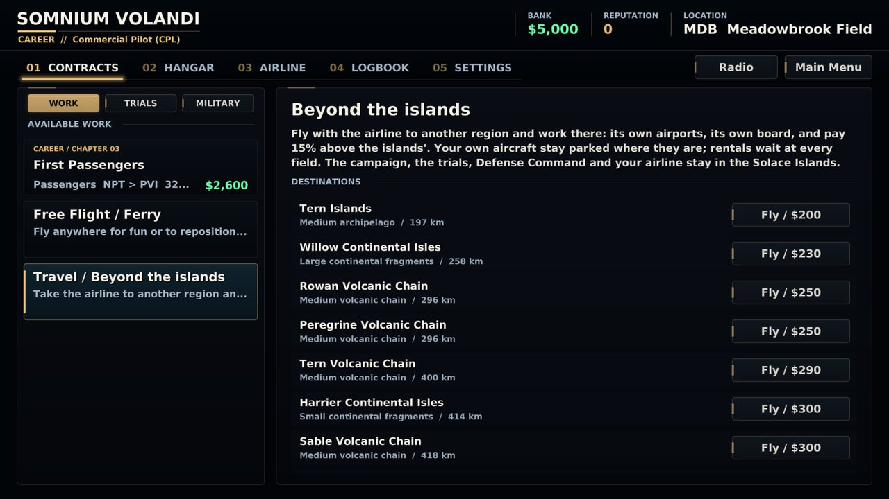</td>
    <td width="50%">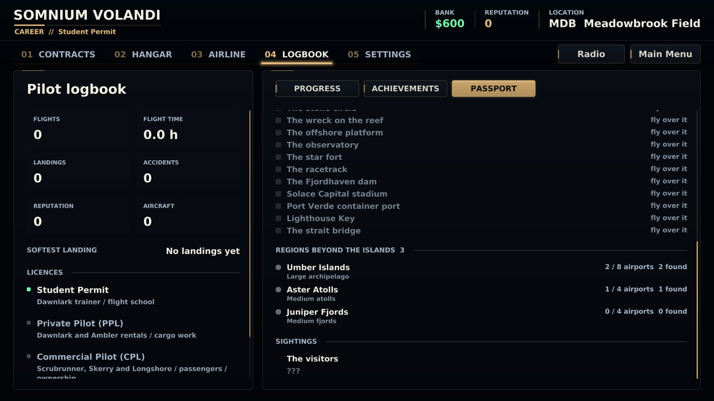</td>
  </tr>
</table>

### Wings over Water

New in 4.0: the sea is somewhere to fly from and to, not only something to fall into.

- **The Kittiwake A9 amphibian.** A nine-seat single turboprop on amphibious floats, its wheels folding up into them.
  Wheels down, it lands on a runway; wheels up, on the water.
- **Floats that behave like floats.** They float at their draft, push a bow wave through the hump, climb onto the
  step and plane, and leave the water when the wing can carry the aircraft. Water rudders steer it at taxi speeds and
  the wind weathervanes it when it stops. The classic mistakes are simulated: land on the water with the wheels down
  and it goes over on its nose, or on a runway with them up and it slides on its keels.
- **Seaplane bases.** Seven in the islands (a sheltered bay below Port Verde, the fjord above Fjordhaven, a lagoon
  behind Palm Bay's reef, villages no runway reaches) and one or two in most generated regions. Each has a buoyed water
  lane and a dock with a pontoon, fuel pump, office and windsock. Flights from a base start moored at the dock; on the
  water the parking-brake control moors you and casts you off.
- **Work on the water.** With a float plane to hand, every job board has a seaplane charter. The autopilot lands on a
  water lane with the wheels up and taxis you in to the dock. An amphibian's gear advisory calls out what the gear is
  set for against the field ahead. Spray, a foam wake, and the floats' hiss make the water show what the floats are
  doing.
- **Floats for your own aircraft.** Six types (the Dawnlark, Ambler, Scrubrunner, Skerry, Longshore and
  Thistledown) take a set of amphibious floats in place of their wheels: bought once in the hangar, swapped on and
  off at a land field, and flown with the floats' weight, drag and hydrodynamics.

<table>
  <tr>
    <td width="50%">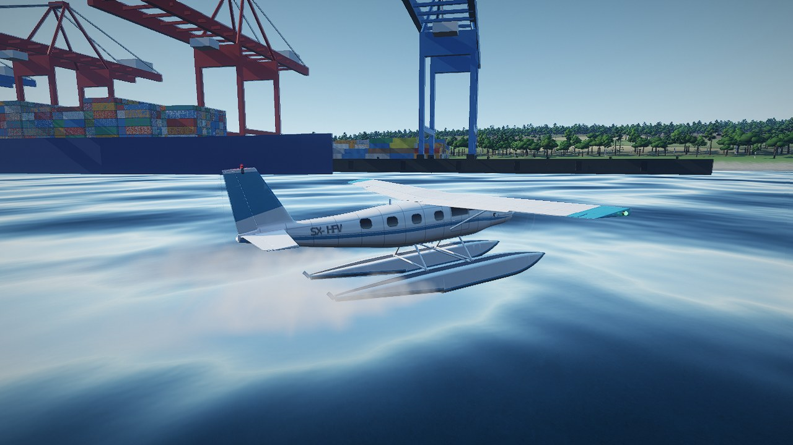</td>
    <td width="50%">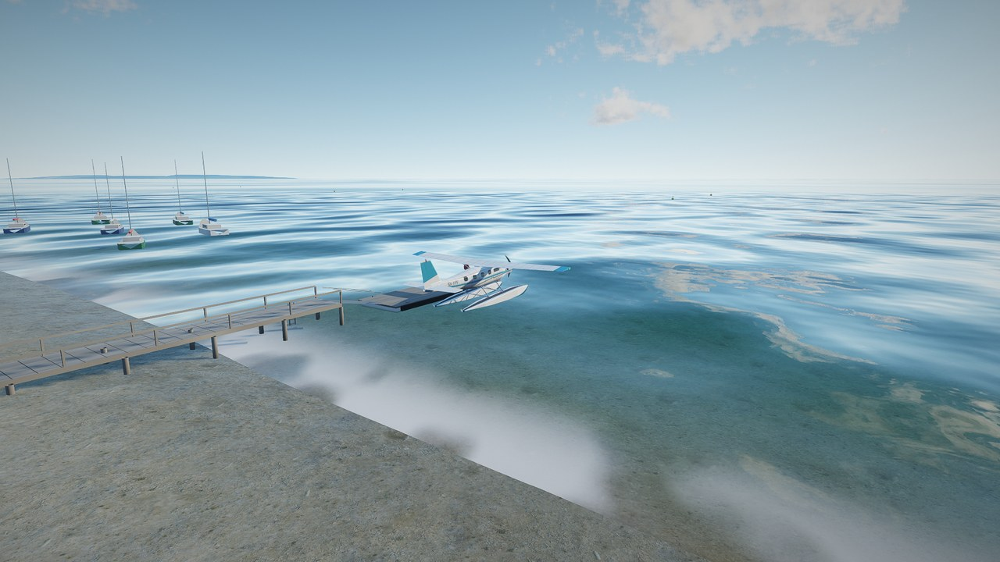</td>
  </tr>
</table>

### Aircraft

Twelve career aircraft, each hand-built down to the rivets, door handles, static wicks and antennas, with moving
control surfaces, gear and props. Each has a 3D cockpit with live gauges or glass displays and controls that move
with your inputs.

| Aircraft | Type | Seats / Cargo | Range | Cruise | Runway | Licence |
|---|---|---|---|---|---|---|
| Dawnlark T2 | Two-seat aerobatic trainer | 1 / 120 kg | 770 km | 118 kt | 410 m paved | Student |
| Ambler 180 | Four-seat tourer | 3 / 320 kg | 1,150 km | 130 kt | 442 m paved | PPL |
| Cutwater S6 | Retractable low-wing tourer | 3 / 420 kg | 1,500 km | 173 kt | 451 m paved | PPL |
| Thistledown L4 | Shoulder-wing tourer | 3 / 130 kg | 1,600 km | 133 kt | 600 m paved | PPL |
| Scrubrunner STOL | Backcountry taildragger | 4 / 480 kg | 1,100 km | 133 kt | 251 m, gravel / snow | CPL |
| Skerry Twin | Nine-seat utility twin | 9 / 900 kg | 1,400 km | 130 kt | 469 m, gravel / snow | CPL |
| Wavecrest C6 | Coastal charter twin | 5 / 270 kg | 1,800 km | 160 kt | 447 m paved | CPL |
| Longshore Hauler | Single turboprop hauler | 12 / 1,400 kg | 1,700 km | 150 kt | 525 m, gravel / snow | CPL |
| Archipel 400 | Regional turboprop airliner | 40 / 4,500 kg | 1,600 km | 265 kt | 780 m paved | ATP |
| Emissary 500 | Light business jet | 7 / 700 kg | 4,350 km | 466 kt | 607 m paved | ATP |
| Galleon 180 | 180-seat twin-engine transport | 180 / 6,500 kg | 5,800 km | 513 kt | 1,900 m paved | ATP |
| Kittiwake A9 | Single-turboprop amphibian | 9 / 900 kg | 1,450 km | 165 kt | 600 m paved, or a water lane | CPL |

The numbers are what each aircraft actually does in the flight model, measured by flying it (`flight_test --table`).
The tanks are real: three to seven hours of fuel for each career type (docs/FUEL.md). Five research craft sit beyond the career:
the XR-10 Vigil, the XR-20 Reverie, the XR-30 Nocturne (Mach 2.85, thrust vectoring), the XR-40 Somnus (Mach 4.4,
four tilting thruster pods, a cloak, lasers and plasma bombs) and the XR-50 Morpheus: a remotely piloted swing-wing
waverider, twice the XR-40 in thrust for its weight, pull and roll (160 g, 800 deg/s), flown from a ground station's
monitors. It takes off vertically on a lift fan and swivelling nozzles, crosses Mach 7 on its scramjets at 27 km and
climbs out of the atmosphere on its rocket, its leading edges glowing at 1,600 °C (docs/XR50.md).

### Flying

- **A flight model built from the airframe.** Six degrees of freedom. Drag is built up part by part from each
  shape, lift and span efficiency come from the wing, and drag rises near the critical Mach number. Cruise speed and
  climb rate come out of that; nothing is tuned to hit a number. It models stalls and wing drop, ground effect, prop
  wash, density altitude, spring-damper gear and taildragger handling.
- **Weather you fly through.** Gusts, turbulence carried by the air, wind shear and veer, ridge lift and lee
  rotors, thermals under cumulus and the downdrafts of storm cells. Some jobs come with a forecast, and the weather
  changes during the flight.
- **An autopilot that flies like a pilot.** Heading, altitude and speed hold, and autoland at any airport you pick
  on the GPS map. It picks the runway from the wind, plans round the terrain, flies the approach, flares, stops and
  sets the brake, and goes around when it isn't stable. It learns each aircraft's envelope by flying it, and refuses
  a field it can't land on, saying why.
- **Air traffic and towers.** Traffic parks, taxis, flies full circuits and lands around you. Tower controllers
  speak from what is actually happening (clearances, sequencing, wake turbulence cautions, go-arounds) and call you
  by your registration.
- **A GPS moving map** over aerial imagery rendered from the real terrain, with the route, a fuel-range ring and the
  predicted track. Time Warp goes up to ×16.
- **Keyboard, gamepad, joystick.** Xbox-style gamepads and any DirectInput stick, throttle, HOTAS or rudder pedals,
  with axis binding, dead zones and curves. Assists are on by default for keys and pads and can be turned off.

### Looks and sound

- **A deferred renderer on OpenGL 3.3.** Continuous level-of-detail terrain, an ocean built from a wave spectrum
  that follows the wind, volumetric clouds that drift, boil and part round your wingtip vortices, aerial
  perspective, soft shadows from cascaded maps, bloom, light shafts and temporal anti-aliasing. 30 tileable PBR
  material sets (23 photo scans) cover the terrain, buildings, vegetation and aircraft.
- **Lights that are fixtures.** Every runway edge light, PAPI unit, nav light, strobe and landing light is a
  modelled fixture that lights its surroundings. PAPI lenses change from red to white per pixel with your eye height.
- **Crashes.** Aircraft come apart along their own joints into simulated pieces that burn, sink or scatter, with
  fireballs, craters and smoke columns. An overstressed airframe breaks up in the air.
- **Binaural audio.** Engines, wind, rain, impacts and voices are placed in 3D, with distance falloff, Doppler,
  head shadow and a headset filter. A cast of eight voices (an instructor, an examiner, the cockpit assistant, the
  research computer and more) speaks from one comms channel, and tower calls come with squelch.
- **Music and radio.** A generative soundtrack with stingers for licences, achievements and medals, and live
  internet radio from your own station list.

### And also

- **Photo mode** (F2): freeze the flight, take a free camera up to 600 m out, grade the shot and save it without the
  HUD.
- **A pilot profile** across careers: 43 achievements, a stamp for every airport you land at, the landmarks you've
  found, and your softest touchdown in each aircraft.
- **Steam ready.** With Valve's `steam_api64.dll` beside the exe it adds achievements, trial leaderboards, rich
  presence, screenshots, the overlay pause and Steam Deck support (with a Deck graphics preset). Without the DLL
  nothing changes. There is no DRM.
- **Crash reports** stay on your PC (`%APPDATA%\SomniumVolandi\crash`), and the next launch tells you where they are.
  Nothing is ever uploaded.

## Getting started

1. Download `SomniumVolandi-windows-x64.zip` from the [latest release](../../releases/latest) and unzip it anywhere.
2. Run `SomniumVolandi.exe`. The first launch compiles the shaders for your GPU and builds the islands; later
   launches load them in moments.
3. Start a **New Career** for the lessons, or pick **Free Flight** to fly any career aircraft from any airport, in the
   islands or in a generated region.

**System requirements.** Windows 10 or 11, 64-bit, and a graphics driver with OpenGL 3.3 (core profile). If the
driver falls short, the game says so and names the fix. About 0.5 GB of disk. A verified minimum and recommended PC
will come from the playtest's [hardware matrix](docs/HARDWARE_MATRIX.md); `diagnostics.bat` benchmarks your own PC.
On a laptop with two GPUs, set the game to *High performance* in Windows' graphics settings if it starts on the
integrated one.

**Where things are kept.** Saves, settings and the radio list are in `%APPDATA%\SomniumVolandi`. The compiled
shaders, the islands and other data rebuilt per machine are in `%LOCALAPPDATA%\SomniumVolandi`; deleting that folder
only means the next launch builds it again.

**Internet radio.** Press **R** in flight. No stations ship with the game. Add one per line to
`%APPDATA%\SomniumVolandi\radio_stations.txt` as `Name|https://example.com/stream.mp3`. Any MP3 or AAC stream that
Windows Media Foundation plays will work; press **Reload** in the radio panel.

## Controls

Open **Controls** from the main menu, the pause menu or Settings to see and remap every binding: click a keyboard,
gamepad or joystick cell and press the new key or button. **Settings → Joystick** binds the flight axes (pitch,
roll, yaw, throttle, toe brakes) with reversal, dead zones and response curves.

| Key | Action | Gamepad |
|---|---|---|
| W / S or ↑ / ↓ | Pitch | Left stick |
| A / D or ← / → | Roll | Left stick |
| Q / E | Rudder and nosewheel | LB / RB |
| Shift / Ctrl, PgUp / PgDn, 1–9, 0 | Throttle | RT / LT |
| F / V | Flaps down / up | B / X |
| G | Landing gear | Y or D-pad → |
| B | Parking brake; on the water, moor or cast off | D-pad ← |
| Space | Wheel brakes | A |
| [ / ] | Elevator trim | D-pad ↑ / ↓ |
| Z | Autopilot hold, or autoland at the airport picked on the GPS | Right-stick click |
| ; | Aerobatics: the autopilot flies the next figure | (bind in Controls) |
| T | Time Warp ×2 / ×4 / ×8 / ×16 / off | |
| C | Camera: chase, cockpit, orbit, flyby | Back |
| Right mouse drag, wheel | Look around, zoom | Right stick |
| N | GPS moving map | |
| Tab | Minimap; with the GPS open, pick the autoland airport | D-pad on the GPS |
| L | Landing lights | |
| I | Engine start; hold to shut down | |
| M | Muffle engine noise | Left-stick click |
| R | Internet radio | |
| H | HUD on / off | LB + RB held |
| F2 | Photo mode | |
| F3 | Performance readout | |
| F11 / Alt+Enter | Fullscreen | |
| Esc | Pause menu | Start |

Menus work with the mouse or a gamepad (the left stick moves a cursor, **A** clicks, **B** backs out).

<details>
<summary><b>Flying tips</b></summary>

- Fly the green rings in the lessons. The navigation card shows the distance, bearing, climb or descent and time to
  the target; the magenta diamond sits on the objective itself.
- On approach the HUD shows a glidepath and localiser guide. The PAPI shows **two white and two red** on a 3° path.
- Touchdowns are graded: **butter** under 150 fpm, **smooth** under 250, **good** to 350, **firm** to 600, and
  **hard** above that (over about 900 fpm the gear gives way).
- After landing on a job, taxi clear and set the parking brake (**B**) to finish. Shut the engine down first (hold
  **I**) for the airmanship bonus.
- High, hot fields need more runway. Summit Pass (5,400 ft) only works in a STOL aircraft.

</details>

<details>
<summary><b>Classified (spoilers)</b></summary>

- Hold **J + K** for a second in flight, well clear of the ground, and the visitors come to you.
- Hold **O + P** for a second and the Nocturne display pair joins you for a show all the way to your destination.
- Hold **U + I** on the main menu (or click both sticks) to open the Project NIGHTGLASS research terminal. It gets a
  menu entry once you hold the Airline Transport licence. The XR-40 Somnus: **F / V** tilt the pods, **X** cloaks,
  **Y** arms the lasers and the bomb bay. The XR-50 Morpheus: **F / V** swivel the nozzles (the lift fan comes in with
  them), a double press of **A** (or **X**) lights the rocket and shuts it off, and a full pull through the stick's
  stop goes post-stall.
  Its cockpit view (**C**) is the ground station it is flown from: its monitors show its cameras with their symbology.

</details>

## Building from source

There are no third-party dependencies to install: the game uses only what Windows provides (Win32, OpenGL, WinMM,
XInput, DirectInput and Media Foundation).

**Visual Studio 2022 or newer (MSVC):**

```
cmake -S . -B build -A x64
cmake --build build --config Release
build\Release\SomniumVolandi.exe
```

**MinGW-w64** (on Windows, or cross-compiling from Linux):

```
cmake -S . -B build-win -DCMAKE_TOOLCHAIN_FILE=cmake-mingw.cmake   # omit the toolchain file on Windows
cmake --build build-win -j
```

The Steam demo is its own target: `cmake --build build --config Release --target SomniumVolandiDemo`.

### Tests

```
ctest --test-dir build -C Release
```

About 160 tests cover the flight model and every aircraft's controls, the campaign's progression, the career, saves
(frozen formats included), the autopilot's approaches, the world and its generated regions, the renderer's shaders
and meshes, the audio and the UI. `tests/gameplay_test.cpp` flies lessons and approaches through the real game loop
on Linux, and `tests/render_harness.cpp` and `tests/ui_review_harness.cpp` render real frames headlessly with Mesa.

CI (`.github/workflows/build.yml`) builds with MSVC, runs the tests, uploads the game as an artifact on every push,
and runs the headless tests again under AddressSanitizer and UBSan. A push runs only the tests its change can affect,
worked out from CMake's description of the build (`tools/ci/select_tests.py`); a change to the build, a manual run,
a tag and the nightly run test everything. Releases are made by a manual run with a release tag.

## Project layout

```
src/
  aircraft.*, aero*.cpp             aircraft specs, the 6-DOF flight model, aerodynamics from the airframe
  aircraft_perf.cpp                 each type's envelope, learned by flying it
  aircraft_stunt.cpp                aerobatic figures on the autopilot
  career.*, profile.*               licences, story, board, economy, travel, saves; the pilot's profile
  world.*, scenery.*                the islands' terrain, airports and scenery masks
  settlements.*, road_*, bridges.*  towns, the road network, its bridges, furniture and traffic
  procedural_regions.*              the generated regions: descriptors, recipes, sights
  geo.*, region_travel.*            geodesy on the sphere; charts and handoffs between regions
  earth_*, world_earth.cpp          the real Earth: the pack reader and its streaming, the installer, charts, far terrain
  distant_regions.*                 far region silhouettes for the horizon
  regional_surface.*                their collision counterparts
  weather.*, sky.*                  the wind field, clouds and rain; the sun, moon and stars
  traffic.*, atc.*                  AI air traffic; the tower controllers
  renderer.*, raster_renderer.cpp   the deferred renderer and its passes
  terrain_mesh.cpp                  the continuous level-of-detail terrain mesh
  entities.*, entity_*              trees, rocks and buildings: placement, meshes, instancing
  aircraft_mesh*                    aircraft meshes baked from their shapes, cockpit parts, mesh cache
  shaders/*.glsl, shaders.h         GLSL modules embedded at build time; the programs built from them
  audio.*, music.*                  the procedural audio engine and the generative score
  game*.cpp, game.h                 game flow, flight sessions, cameras, effects, HUD and menus
  hive_*, military_missions.h       the military board and enemy combat
  platform_win32.cpp, *_win.cpp     the Windows window, input, joysticks, radio and crash reports
  steam.*                           Steamworks, loaded at runtime
tests/                              CTest suites, the render and UI harnesses, fixtures
tools/                              shader embedding, material packing, CI test selection, mesh, voice, Steam, the Earth pack builder (earth2)
assets/                             materials, voices, cockpit layouts, loading pictures, icons
steam/                              Steamworks configuration, store assets, upload scripts
docs/                               design notes (below) and the README's pictures (docs/media)
```

## Documentation

| Document | What it covers |
|---|---|
| [RELEASE_NOTES.md](RELEASE_NOTES.md) | What changed in each version |
| [docs/WINGS_OVER_WATER.md](docs/WINGS_OVER_WATER.md) | 4.0: the amphibian, float hydrodynamics, seaplane bases, mooring, the autopilot and the career on the water |
| [docs/PROCEDURAL_EARTH.md](docs/PROCEDURAL_EARTH.md) | The generated regions: recipes, sizes, sights, the career's travel and long hauls |
| [docs/LIVING_ISLANDS_PLAN.md](docs/LIVING_ISLANDS_PLAN.md) | The islands' towns, roads, bridges, landmarks and traffic |
| [docs/PILOT.md](docs/PILOT.md) | The autopilot: how it learns an aircraft and flies it |
| [docs/RENDERER_REBUILD.md](docs/RENDERER_REBUILD.md) | The deferred renderer and its passes |
| [docs/AIRCRAFT_AUTHORING.md](docs/AIRCRAFT_AUTHORING.md) | Adding an aircraft, from its numbers to its cockpit and tests |
| [docs/COCKPIT_INTERIORS.md](docs/COCKPIT_INTERIORS.md) | Cockpit layouts and crew-station fit |
| [docs/FUEL.md](docs/FUEL.md) | Real fuel: every type's tanks, burn and endurance; reserves; rationed missions; long hauls |
| [docs/JET_FUEL.md](docs/JET_FUEL.md) | Jet fuel burn and endurance calibration |
| [docs/HANGAR.md](docs/HANGAR.md) | Floats for six types, the mechanic's kits, one airframe as it is fitted |
| [docs/HIVE_COMBAT_DESIGN.md](docs/HIVE_COMBAT_DESIGN.md) | The military enemies' combat simulation |
| [docs/AUDIO_PASS.md](docs/AUDIO_PASS.md) | The spatial audio mix and its tests |
| [steam/README.md](steam/README.md) | Steamworks settings, achievements, the demo and the upload |
| [docs/PLAYTEST_KIT.md](docs/PLAYTEST_KIT.md), [docs/HARDWARE_MATRIX.md](docs/HARDWARE_MATRIX.md) | Running a closed playtest and measuring PCs |
| [docs/CODE_SIGNING.md](docs/CODE_SIGNING.md) | Signing the release executable |
| [docs/REAL_EARTH_PLAN.md](docs/REAL_EARTH_PLAN.md) | The real Earth: the data pack, its streaming install, charts, sliding flight and the career on it |
| [docs/XR50.md](docs/XR50.md) | The XR-50 Morpheus: its propulsion, airframe and ground station |
| [docs/COLLABORATION.md](docs/COLLABORATION.md) | How the agents and reviewers work on the repository |
| [docs/CODE_REWORK_PLAN.md](docs/CODE_REWORK_PLAN.md) | The code's shape as measured, and what should be reworked, in order |

## Copyright

Copyright (c) 2026 CDAIII. All rights reserved. See [LICENSE](LICENSE); third-party components are listed in
[THIRD_PARTY_NOTICES.md](THIRD_PARTY_NOTICES.md). Playing the game is covered by the [EULA](EULA.md), and how it
handles data (it keeps everything on your computer and sends nothing) is in the [privacy notice](PRIVACY.md).
