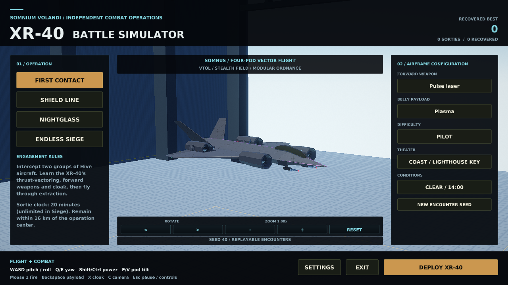
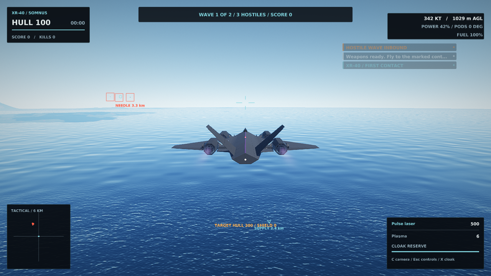

# XR-40 Battle Simulator

A standalone, offline, single-player Windows battle simulator built around Somnium
Volandi's original **XR-40 Somnus**. Select an operation, equipment, difficulty,
theater and weather; deploy directly into the aircraft; fight the Hive; resupply
when necessary; extract to bank your score.





## Run the portable build

Extract the entire `XR40Battle-windows-x64.zip` archive, open the `XR40Battle`
folder and run **XR40Battle.exe**. Keep `aircraft`, `materials`, `voice`, `cockpits`
and `loading` beside the executable. No Somnium Volandi installation, Steam login,
career unlock or network connection is required.

The native runtime is Windows x64 with an OpenGL 3.3 capable graphics driver.
Aircraft meshes are included; driver-specific shaders still compile on first
launch. The provided development build is unsigned. Graphics, audio, assist,
keyboard, gamepad and HOTAS settings are available in the hangar and pause menu.

## Operations

| Operation | Objective | Recovery |
| --- | --- | --- |
| First Contact | Clear two interceptor waves | Enter extraction after the final wave |
| Shield Line | Defend the ground relay through three waves | Keep the relay alive, then extract |
| Nightglass | Clear four escalating waves ending with an Archon | Defeat the command ship and its escorts, then extract |
| Endless Siege | Survive escalating waves; an Archon appears every third wave | Extract during the 25-second interval between waves, or continue |

Cadet, Pilot and Ace change encounter strength, incoming damage and the defense
objective's durability. Lighthouse Key, Spine Pass and Solace Capital use their
authored terrain. Clear afternoon, dusk and storm conditions affect the original
weather/flight simulation. A selectable seed fixes encounter placement; replaying
the same configuration repeats the encounter setup.

Finite sorties have a 20-minute limit. Stay within 16 km horizontally of the
operation center; leaving it starts a visible 20-second return countdown.
All aircraft and outstanding hostile projectiles must clear before a wave ends.
Kills and cleared waves earn points. Successful extraction adds a hull bonus and
banks the best score. An abort or loss records the sortie without banking its score.

## Flying and fighting

| Default input | Action |
| --- | --- |
| W / S; A / D | Pitch; roll |
| Q / E | Yaw |
| Shift / Ctrl | Increase / decrease thrust |
| F / V | Increase / decrease pod tilt |
| Left mouse button | Fire forward weapon |
| Backspace | Release belly payload |
| Y | Toggle weapon arming; the sortie starts armed |
| X | Toggle cloak |
| C | Cycle cameras, including the original cockpit |
| Escape | Pause, controls, settings, restart or abort |

Pulse laser, kinetic and heavy forward weapons retain their own ammunition,
heat, recoil, projectile speed and mass. Plasma, penetrator and EMP payloads
retain their original effects. The HUD adds contact markers, a projectile lead
cue, target hull/shield status, heading-relative radar, ammunition/heat, cloak
reserve, hull, fuel, airspeed and altitude above terrain. Amber contacts are
telegraphing an attack.

Cloak reduces enemy acquisition range; it does not remove projectiles already in
flight or make collisions harmless. It lasts up to 14 seconds, recharges over 22
seconds, breaks when firing, and after exhaustion must recover to 25% before
reactivation. Enemies can still pursue the aircraft.

The cyan supply gate marks a service volume. Hold **within 250 m of its center**
and **below 40 m/s** for five seconds with weapons idle and cloak off. Service
restores ammunition, fuel and cloak reserve, repairs 40 hull, and costs up to 150
points. Its cooldown is 45 seconds. Use pod tilt and thrust control to slow down;
this remains the actual six-degree-of-freedom aircraft, including terrain impact,
breakup and fuel consumption. Extraction uses a 350 m radius and no speed limit.

Settings and `battle.cfg` are stored in `%APPDATA%\XR40Battle`; rendering caches
are in `%LOCALAPPDATA%\XR40Battle`. A backup record is retained as `battle.cfg.bak`.
The debrief reports save failures and offers Retry Save. Screenshots use
`Pictures\XR-40 Battle`. Existing Somnium Volandi career/profile files are outside
the standalone product's storage paths.

## Code analysis and architecture

This implementation starts from `chad04220/Solace-Express`, whose current product
is Somnium Volandi, on base commit
`d0e971d0c1a612325c39d67adc3fa2548fbd5f5f`.
The XR-40 is `kSomnus` / `xr40_somnus` in the current roster. Code uses the named
constant, including the asset exporter, rather than a historical numeric index.

| Existing code | Finding | Role in the standalone |
| --- | --- | --- |
| `aircraft.cpp`, `models.cpp` | XR-40 already has four-pod force/torque allocation, fly-by-wire control, real payload mass and six-axis physics | Central aircraft and physics backbone |
| `game_somnus.cpp`, `hive_loadout.*` | Original weapons, release paths, recoil, heat, ammunition, cloak visuals and effects are implemented | Actual combat equipment, plus bounded cloak endurance and supply gates |
| `hive_combat.*` | Deterministic 60 Hz simulation, bounded actor/projectile/event pools, four enemy roles and world collision callbacks | Encounter simulation, with a default-neutral player signature input for stealth |
| `game.cpp`, career/profile code | Original boot prepares the career, performance envelopes and broader fleet | Dedicated battle initialization and lifecycle bypass those activities |
| `renderer.*`, `raster_renderer.cpp` | Aircraft shaders and mesh preparation can be selected by model | Only the XR-40 exterior/cockpit and four XR-40 shader work items are scheduled |
| `platform_win32.cpp` | Existing input, audio, graphics startup, crash handling and cache management | Dedicated executable identity and isolated save/cache paths |

`xr40_battle.*` is the graphics-independent sortie director. It owns the operation
state machine, waves, extraction, objective health, scoring, cloak reserve,
boundary rules and resupply timing. `game_battle.cpp` connects it to the real
aircraft, weapons, world, UI, records and launch/loading barrier. The public
`Game::battleOnly` switch is enabled by `SOMNIUM_XR40_BATTLE` only in the dedicated
platform target. The existing game can still be built from this branch.

### Optimization scope

- Startup aircraft preparation is **2 views instead of 30**. Shader-helper work
  is restricted to the **4 XR-40 items**, rather than the full 46-item roster.
- Both views are freshly exported through the original production builder and
  included as validated portable geometry. There is no decimation, normal
  repacking, reduced AO, or driver shader binary in the package.
- The battle runtime skips civilian traffic, airline scheduling, career/profile
  progression, research fleet performance learning, distant-region horizon work,
  Earth streaming and proactive autopilot approach profiling.
- A dedicated hangar room avoids menu-time island scenery streaming.
- Combat retains bounded pools: 8 actors, 96 projectiles and 128 queued events.
  Waves initially use at most 6 actors, reserving room for Archon reinforcements.
  Common player effects reserve their expected storage up front.

This is an independent executable and gameplay loop using shared engine sources.
Some dormant career/Earth code still links into the executable; it is not a
minimal source-only extraction of the engine. The authored archipelago is still
loaded for combat terrain. There is no multiplayer, online leaderboard or
additional playable aircraft in this product.

## Build and verify

Windows, Visual Studio 2022 with the C++ desktop workload and CMake:

```powershell
cmake -S . -B build-xr40 -A x64 -DXR40_BATTLE_ONLY=ON
cmake --build build-xr40 --config Release --target XR40Battle xr40_battle_test xr40_battle_fastmath_test xr40_battle_game_test --parallel 2
ctest --test-dir build-xr40 -C Release --output-on-failure
```

The executable is `build-xr40/Release/XR40Battle.exe`. For Linux-hosted MinGW,
configure with `-DCMAKE_TOOLCHAIN_FILE=cmake-mingw.cmake`; the result is still a
Windows executable. Linux hosts run the headless tests and EGL render harness:

```sh
cmake -S . -B build-xr40 -DXR40_BATTLE_ONLY=ON -DCMAKE_BUILD_TYPE=Release
cmake --build build-xr40 --target xr40_battle_test xr40_battle_fastmath_test xr40_battle_game_test xr40_battle_render aircraft_mesh_export --parallel 2
ctest --test-dir build-xr40 --output-on-failure
LIBGL_ALWAYS_SOFTWARE=1 build-xr40/aircraft_mesh_export --xr40 out/xr40-aircraft
LIBGL_ALWAYS_SOFTWARE=1 build-xr40/xr40_battle_render out/xr40-review 1280 720 scene out/xr40-aircraft
```

The geometry destination must be new. `--xr40` produces a scoped, complete report
only after both fresh workers succeed. Diagnostic `--bake-one` output, stale
geometry, driver caches and partial exports cannot be used by the product packager.
The original 30-view release export and validator remain available.

Package using the source manifest from the **Windows executable's own build**:

```sh
python tools/package_xr40.py --exe build-xr40-windows/XR40Battle.exe --aircraft out/xr40-aircraft --source-manifest build-xr40-windows/gen/aircraft_geometry_source.json --output out/XR40Battle-windows-x64.zip
```

The packager rehashes current source inputs, validates both full-quality mesh
payloads, checks executable architecture, includes required runtime assets and
licensing, writes a per-file SHA256 manifest, and verifies ZIP contents. Its output
path must be new. `.github/workflows/xr40-battle.yml` automates Linux sanitizers,
fresh geometry export, Windows MSVC tests and the portable artifact.

### Validation boundaries

The headless director tests cover all mode/difficulty combinations, complete wave
and extraction flows, relay/player loss, boundary timeout, timestep variation,
cloak acquisition, resupply and score finalization. Game integration checks all
mode/theater launches, actual aircraft/equipment mass, terrain clearance, pause,
loading cancellation, cleanup, records, backup recovery and civilian-save
isolation. Existing Hive, loadout and military gameplay regressions are retained.
The director passes 235 checks in both ordinary and fast-math builds, and the Game
integration suite passes 127 checks. Linux ASan/UBSan covers these three binaries.
Sanitizer teardown also exposed a shared scenery-cache lifetime bug: construction
now precedes worker-pool completion, so workers join before that cache is freed.

The Windows x64 executable was cross-compiled on Linux. Native UI and production
3D review run through Mesa/EGL, including hangar, exterior and cockpit. These are
functional checks, not a Windows GPU performance benchmark. Interactive Windows
play, real audio devices and physical HOTAS/gamepad input still require a Windows
machine. No specific laptop FPS or complete long-session balance claim is made.
