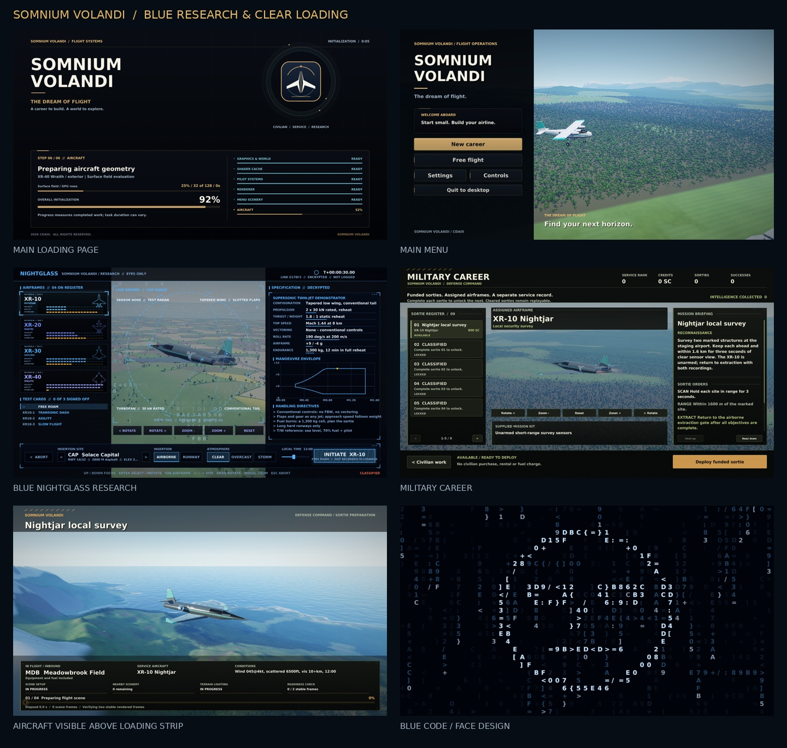

# Somnium Volandi preview gallery

[Implementation and Claude integration handoff](../CLAUDE_SOMNIUM_VOLANDI_UI_REVIEW.md)



The main menu, Hangar, all four Research airframes and Military aircraft images below render the actual game scene. The startup/loading images render the production UI against explicit review states. The XR-40 and compact Research/Military files retain their earlier Layout filenames, but now include the actual aircraft render. The code motifs are the isolated native ambient effect, shown without the aircraft-protection fade. These distinctions are intentional; none of the images is a generated concept mockup.

| Capture | View |
| --- | --- |
| Startup and completed state | [Startup](previews/Startup.png), [Ready](previews/Startup-Ready.png) |
| Main menu and showroom | [Main menu, live 3D](previews/Main-Menu.png), [Hangar, live 3D](previews/Hangar.png) |
| Research | [XR-10, live 3D](previews/Research.png), [XR-40, live 3D](previews/Research-XR40-Layout.png), [Access/loading layout](previews/Research-Boot-Layout.png) |
| Military Career | [XR-10, live 3D](previews/Military-Career.png), [XR-40, live 3D](previews/Military-XR40-Layout.png), [Loading layout](previews/Military-Loading-Layout.png) |
| Civilian preparation | [Loading](previews/Flight-Loading-Layout.png), [Ready to fly](previews/Flight-Ready-Layout.png) |
| Compact window | [Startup](previews/Compact-Startup.png), [Research](previews/Compact-Research-Layout.png), [Military Career](previews/Compact-Military-Layout.png) |
| Ambient code | [Face](previews/Code-Face.png), [Swept wing](previews/Code-Wing.png), [Helix](previews/Code-Helix.png) |

## Blue Research and aircraft visibility update

Research now uses electric blue, ice-blue highlights and deep blue-black surfaces throughout its terminal, access sequence, code motifs and flight preparation. Military retains its olive/charcoal/amber identity. Classified aircraft show a clear outline of their real rendered geometry with all material details hidden. Model changes clear temporal history in indoor and outdoor previews.

Flight-loading details occupy a shallow bottom strip rather than covering the aircraft photograph. It preserves departure/route, aircraft, weather, four readiness bars, current work, percentage and elapsed/counter detail. Minimum font sizes keep the compact strip readable. The native fallback camera uses the same unobstructed image region.

[All 15 aircraft previews](previews/All-Aircraft-Previews.jpg) · [52 native preview states / 104 verified frames](native-preview-validation.json) · [Render log](logs/blue-native-preview-render.log) · [Compact render log](logs/blue-native-compact-render.log)

| Additional capture | View |
| --- | --- |
| Research native aircraft | [XR-20](previews/Research-XR20.png), [XR-30](previews/Research-XR30.png), [XR-40](previews/Research-XR40-Layout.png) |
| Classified military outlines | [XR-20](previews/Military-Classified-XR20.png), [XR-40](previews/Military-Classified-XR40.png) |
| Loading image visibility | [Wraith loading](previews/Military-Loading-XR40.png), [Compact loading](previews/Compact-Military-Loading.png) |
| Blue code animation | [Animated face reveal](previews/Code-Motion.gif) |

All 15 Hangar previews are in [previews/airframes](previews/airframes). Native render checks cover 15 Hangar entries, 11 Free Flight entries, all four Research airframes, and the nine Military assignments in fresh/locked and unlocked states at 1280×720. Four additional 800×600/140% states cover classified Hangar, Research, unlocked Military and classified Military. Every frame has actual aircraft G-buffer pixels. Classified frames also require visible outline pixels and a hidden interior before the UI is drawn. The diagnostic pre-bakes the selected production mesh; it is not a cold-start benchmark.

A further 16 rendered frames checked aircraft changes across the four Research models and locked/unlocked XR-20/XR-40 Military assignments after temporal-history reset was corrected. [Transition render log](logs/blue-preview-transitions.log).

The native Release build and Windows x64 cross-build passed. Loading progress, gameplay, preview input, catalog and geometry checks passed. Additional regression checks project the entire assigned loading aircraft between the header and strip for all nine missions at five viewport sizes. The 800×600/140% interaction batch and reduced-motion equality were checked after the blue-theme changes.

## Validation

- Native Release C++ build: production UI renderer, complete game object libraries and both review harnesses built successfully.
- Windows x64 MinGW Release cross-build: `SomniumVolandi.exe` linked successfully with the new icon and VERSIONINFO resource. This is a cross-build, not a native Windows gameplay run.
- Nine selected CTest checks passed: loading progress, logical shader completion/failure behavior, shader keywords, military progression, military gameplay, preview controls, aircraft catalog, hangar geometry and the world fixture.
- Hive game integration and diskless diagnostic source-contract checks passed; workflow YAML parses.
- Loading snapshot tests exercise monotonic completion, concurrent snapshot readers, restarting GPU batches, invalid values, grouped views and skipped optional work. Skipped cache work is exposed as **SKIPPED**, never as completed graphics work.
- The UI interaction harness passed at 1280×720/100% and 800×600/140%: repeated keyboard/mouse aircraft selection, incompatible test reset, airport wrapping, weather/start settings, Research equipment, scroll/focus reachability, preview controls, catalog navigation, free flight, Escape and loading readiness. Military gameplay/preview tests were repeated after the final warm-up wiring; loading snapshot tests were repeated after the final skip-state presentation change.
- Layout renders were inspected at 1920×1080 and 800×600. Live 3D captures were inspected at 1280×720 on Mesa llvmpipe. Long task strings are fitted, side rails remain readable over the scene, and the code fades around the aircraft stage.
- The reduced-motion code field produced identical pixel buffers at two different capture timestamps.
- Icon generation validated the seven ICO resolutions and antialiased edges. PNG previews were recompressed losslessly and their pixel buffers compared with the originals. Dimensions and SHA-256 values are in [preview-manifest.json](preview-manifest.json).

Relevant command forms, from the repository root:

```bash
cmake -S . -B build -DCMAKE_BUILD_TYPE=Release
cmake --build build --target ui_review_harness load_pacer_test shader_keyword_test military_career_test military_gameplay_test hangar_preview_controls_test hangar_catalog_test -j 6
ctest --test-dir build -R '^(loading_progress|shader_keywords|shader_loading_contract|military_career|military_gameplay|hangar_preview_controls|hangar_catalog|hangar_geometry)$' --output-on-failure
SHADERCACHE=/tmp/somnium-ui-cache build/ui_review_harness interactions /tmp/somnium-interactions 800 600 1.4 ui
SHADERCACHE=/tmp/somnium-ui-cache build/ui_review_harness intro_0.92_5,research40_face,military8_unlocked,loading /tmp/somnium-layouts 1920 1080 1 ui
cmake --build build --target ui_review_hangar_harness -j 6
SHADERCACHE=/tmp/somnium-scene-cache FRAMES=2 build/ui_review_hangar_harness menuT5,hangar0,research10 /tmp/somnium-live 1280 720 1 scene
```

Windows builds use the existing target name `SolaceExpress`; it outputs `SomniumVolandi.exe`.

## Remaining integration checks

Run the normal CI/asset-packaging workflow, then check native Windows first/cached startup, Research warm-up, civilian/military loading, taskbar/file-properties icon, keyboard/Xbox input and actual GPU frame times. A driver shader compile can still pause its own completion count: it is named and timed, not given fabricated percentage advancement. Linux software rendering and Windows cross-compilation do not measure the owner's GPU or establish a native Windows startup result.
